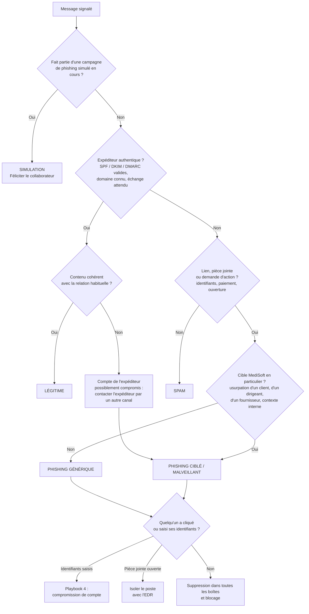

# Qualification des messages signalés

| Référence | MS-ENR-04 | Classification | C1 — Interne |
|---|---|---|---|
| Période | Semaine du 18 au 22/01/2027 | Analyste | RSSI |

> Méthode utilisée pour qualifier les messages suspects signalés par les collaborateurs (playbook 1, étape 1), puis application aux 8 signalements d'une semaine.

## 1. Catégories

| Catégorie | Définition | Gravité | Traitement |
|---|---|---|---|
| **Légitime** | Message authentique, signalé par prudence | — | Réponse au collaborateur, remerciement |
| **Spam** | Message indésirable, commercial, sans intention malveillante | G1 | Blocage de l'expéditeur si récurrent |
| **Phishing générique** | Tentative de vol d'identifiants ou de fraude, envoyée en masse | G1 (G2 si clic) | Suppression dans toutes les boîtes, blocage |
| **Phishing ciblé / malveillant** | Message visant MediSoft en particulier (usurpation d'un client, d'un dirigeant, d'un fournisseur) ou contenant une pièce jointe malveillante | G2 minimum | Playbook 1 complet, alerte interne |
| **Simulation** | Campagne de phishing simulé de MediSoft | — | Confirmation au collaborateur : bon réflexe |

## 2. Arbre de qualification

## 3. Indices à vérifier

| Élément | Ce qu'on regarde |
|---|---|
| **Expéditeur** | Adresse réelle (pas seulement le nom affiché), domaine ressemblant (`medisoft-support.com`, lettres inversées), résultats SPF, DKIM et DMARC dans les en-têtes |
| **Liens** | Destination réelle du lien (survol), domaine récemment créé, raccourcisseurs d'URL, page imitant la connexion Microsoft |
| **Pièces jointes** | Formats à risque : `.iso`, `.img`, `.html`, `.js`, `.lnk`, archives protégées par mot de passe, documents Office avec macros |
| **Contenu** | Urgence, menace, demande inhabituelle (paiement, changement de RIB, codes MFA), fautes, contexte qui ne correspond pas à la relation habituelle |
| **Contexte** | Le même message est-il arrivé chez d'autres collaborateurs ? L'expéditeur a-t-il déjà écrit ? |

## 4. Signalements de la semaine du 18/01/2027

Les domaines utilisés sont fictifs.

| N° | Signalé par | Message | Indices | Qualification | Actions |
|---|---|---|---|---|---|
| S-01 | Support N1 | « Votre boîte mail est pleine, validez votre compte sous 24 h » | Domaine `office-verif.example`, page imitant Microsoft, urgence | **Phishing générique** — G1 | Supprimé de 14 boîtes ; domaine bloqué ; aucun clic |
| S-02 | Comptable | « Message du DG » : demande de virement urgent et confidentiel pour une acquisition | Nom du DG mais adresse Gmail ; demande de discrétion ; urgence | **Phishing ciblé** (fraude au président) — G2 | Aucun virement ; alerte au service finance ; rappel de la procédure de double validation des paiements |
| S-03 | Support N2 | Une « clinique cliente » envoie un lien « Dossier patient à consulter » | Nom d'un vrai client, domaine `clinique-xxx-sante.example` ressemblant ; page de connexion imitant MediSoft Care | **Phishing ciblé** — **G3** | 1 agent a saisi ses identifiants → **playbook 4** : sessions révoquées, MFA vérifié (la connexion de l'attaquant a été bloquée par le MFA) ; client prévenu que son nom est usurpé ; alerte interne |
| S-04 | Développeur | Facture GitHub du mois | SPF / DKIM / DMARC valides, domaine officiel, montant habituel | **Légitime** | Réponse et remerciement |
| S-05 | Commercial | Newsletter d'un salon professionnel | Aucun lien malveillant, désinscription possible | **Spam** — G1 | Conseil de désinscription |
| S-06 | RH | Candidature avec pièce jointe `CV_Julie.iso` | Format `.iso` inhabituel pour un CV | **Phishing ciblé** (pièce jointe malveillante) — G2 | Pièce jointe non ouverte ; analysée en bac à sable : chargeur de maliciel ; format `.iso` bloqué sur la messagerie |
| S-07 | Marketing | « Mise à jour de vos informations bancaires » de la part d'un fournisseur | Fournisseur réel, mais demande de changement de RIB par simple mail | **Phishing ciblé** (fraude au RIB) — G2 | Fournisseur contacté par téléphone au numéro habituel : il n'a rien envoyé ; RIB non modifié ; fournisseur informé (sa messagerie est peut-être compromise) |
| S-08 | Ops | « Colis en attente, frais de livraison de 1,99 € » | Domaine imitant un transporteur, demande de carte bancaire | **Simulation** (campagne CyberQuiz n° 2) | Bon réflexe confirmé à l'agent |

## 5. Bilan de la semaine

- **8 signalements** : 1 légitime, 1 spam, 1 phishing générique, 4 phishing ciblés, 1 simulation.
- **1 incident G3** (S-03) : la MFA a empêché la compromission malgré la saisie des identifiants. C'est la preuve concrète de l'intérêt de la MFA généralisée (constat EBIOS n° 1).
- **Tendance :** 4 messages ciblent MediSoft en usurpant des clients, des dirigeants ou des fournisseurs. Une **alerte interne** a été diffusée (voir `communication/Alerte_securite_2027-01.md`).
- **Amélioration :** blocage des pièces jointes `.iso`, `.img` et `.lnk` sur la messagerie ; règle de « double validation » des changements de RIB rappelée aux services finance et achats.
